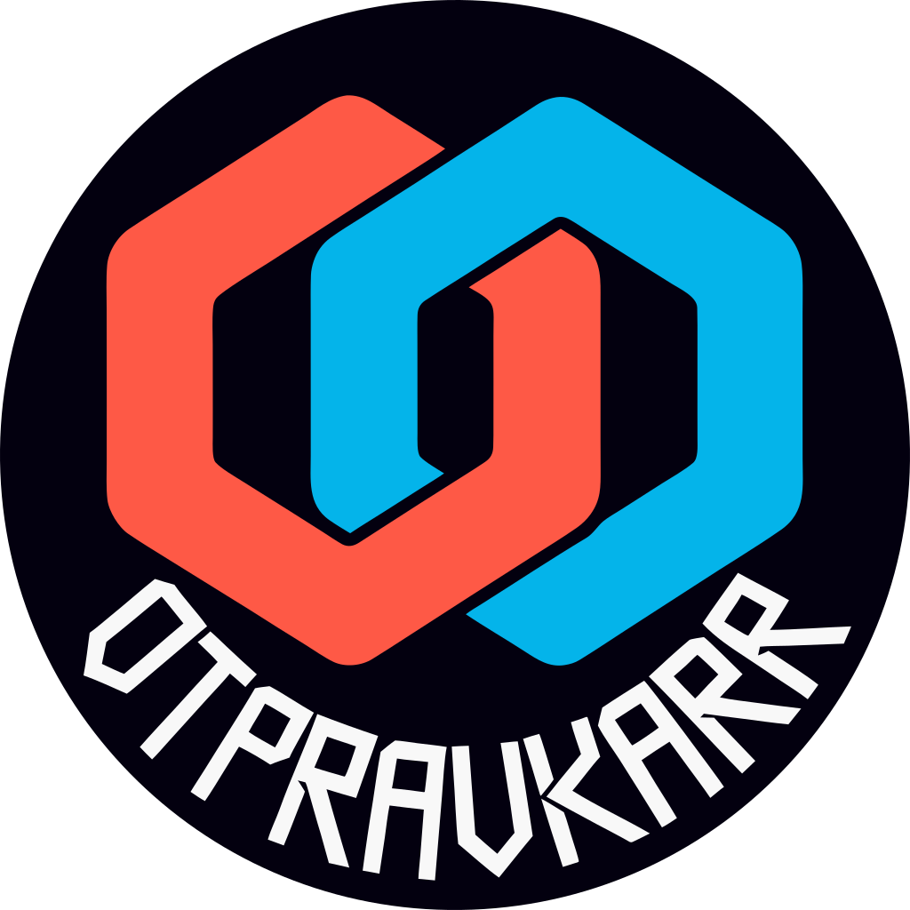

<p align="center">
  
</p>

<h1 align="center">otpravkarr-docker</h1>

<p align="center"><strong>Multi-architecture Docker packaging for Otpravkarr</strong></p>

<p align="center">
  <a href="https://github.com/edbfi/otpravkarr-docker/blob/release/LICENSE" title="Docker packaging license; the application is licensed separately">
    
  </a>
  <a href="https://github.com/moby/moby" title="Moby source, the open-source foundation of Docker Engine">
    
  </a>
  <a href="https://git.savannah.gnu.org/cgit/bash.git/" title="GNU Bash source">
    
  </a>
</p>

<!-- Logo copied verbatim from https://github.com/edbfi/repo-patches/blob/cf9cf0d625c8c7b02982c6453d899c1c2c0fb1a6/hweb-content/assets/img/image-logos/otpravkarr.svg -->

Nightly builds from the latest commit on `main`.

Documentation: [web.edb.fi](https://web.edb.fi/containers/otpravkarr/). The `release` branch builds the latest otpravkarr release tag; none has been published yet.

## Environment Variables

### `ORIGIN`

Set `ORIGIN` to the address people open in the browser, for example `http://192.168.1.10:3000`. It is **required when serving plain HTTP**: without it Otpravkarr assumes `https://<Host>`, so signing in and saving changes fail. Leave it unset only behind an HTTPS reverse proxy that passes the original `Host`. It must be a bare origin (no path, query or credentials), or the app does not start.

```yaml
environment:
  - ORIGIN=http://192.168.1.10:3000
```

Behind a reverse proxy, set `ADDRESS_HEADER=x-forwarded-for` (and `XFF_DEPTH` to the number of proxies, default `1`) only when every request goes through that proxy, so the app sees the real client address. `PROTOCOL_HEADER` and `HOST_HEADER` are for setups without `ORIGIN`, behind a trusted proxy.

### `SHUTDOWN_TIMEOUT`

Seconds the app waits for open requests when the container stops. The image sets `5` so a plain `docker stop` (10 s) finishes cleanly; if you raise it, raise the stop timeout too (`docker stop -t`, `stop_grace_period`).

### `OTPRAVKARR_SECRET` (required)

A stable secret of at least **32 characters** that persists across container restarts. The container will refuse to start if this variable is unset or too short.

> **Warning:** This value must remain stable. It derives the AES-GCM keys used to encrypt configuration (e.g. Plex admin token, Dispatcharr API key) and per-user Xtream passwords. If it changes, all previously-encrypted rows become permanently unreadable.

Generate one with:

```sh
openssl rand -base64 48
```

Then provide it via your compose file or an env file kept outside version control:

```yaml
environment:
  - OTPRAVKARR_SECRET=<paste value here>
```

## Building

Images are built and published by the Hotio workflows in `edbfi/base-image`. `.github/workflows/call-build.yml` runs on every push (except to a branch named `workflows`) and builds linux/amd64 and linux/arm64, then publishes `ghcr.io/edbfi/otpravkarr-docker:<branch>`, `<branch>-<commit>` and `<branch>-<version>`. `.github/workflows/call-update.yml` runs hourly: it evaluates the `__command` keys in `meta.json` (the latest `main` commit as `version`, the current `alpinevpn` base image as `upstream_tag_sha`) and commits any change, which triggers a new build. The workflow's smoke test is off (`test_amd64`, `test_arm64`), because the container does not start without `OTPRAVKARR_SECRET`.

To build locally, run `./build.sh amd64` or `./build.sh arm64` from the repository root (needs `docker` and `jq`); `./build.sh update` refreshes `meta.json` the way the hourly workflow does.
